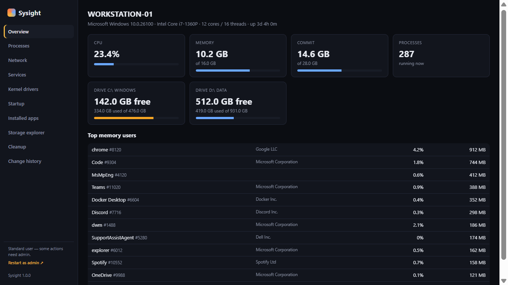

# Sysight

See and control everything running on your Windows PC: processes, network connections, services, kernel drivers, startup apps, installed apps and disk space. Every change you make can be undone.



## Features
- Live CPU, memory and drive monitor
- Processes with publisher, CPU, memory and path; end non-critical ones
- Network connections and listening ports with the owning process
- Services: start, stop, set Manual, disable (third-party only; Windows services are protected)
- Kernel drivers with signer and risk flags (view-only)
- Startup apps on/off (same switch as Task Manager)
- Installed apps with sizes and uninstall
- Storage explorer by folder size
- Safe cleanup of rebuildable caches
- Change history with one-click Undo

## Build
Requires Windows 10 2004+ and the .NET 10 SDK.
```powershell
dotnet run --project src/Sysight              # run
./packaging/build-msix.ps1                    # self-contained MSIX in out/
src/Sysight/bin/.../Sysight.exe --selftest out.txt   # headless check of every backend command
src/Sysight/bin/.../Sysight.exe --shots docs/screenshots   # regenerate Store screenshots from demo data
```

## Layout
- `src/Sysight/Program.cs`: WinForms host + WebView2 bridge + all system logic
- `src/Sysight/ui.html`: the whole UI (includes demo data used with `?demo`)
- `packaging/`: MSIX manifest template, build script, asset generator
- `docs/`: Store listing, submission guide, privacy policy, screenshots

## Privacy and terms
No telemetry and no network calls. See the [Privacy Policy](https://niksheyyadav.github.io/sysight/privacy.html) and [Terms of Use](https://niksheyyadav.github.io/sysight/terms.html).

Third-party licenses: [THIRD-PARTY-NOTICES.txt](src/Sysight/THIRD-PARTY-NOTICES.txt).

Microsoft, Windows and Microsoft Edge are trademarks of the Microsoft group of companies. Sysight is not affiliated with Microsoft.
